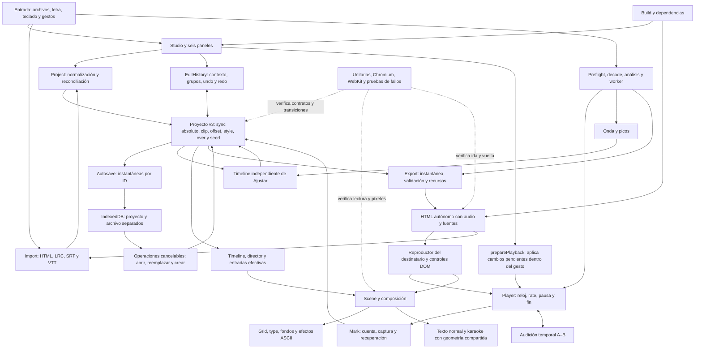

# Auditoría integral del repositorio

Base: `117097d741cd5bff5db68c27a09685967c97bfc6`, producción al comenzar esta revisión. Auditoría solicitada por el usuario después de los PR #4 y #5. Las pruebas y capturas de esta revisión se generan de nuevo; la evidencia histórica se conserva como contexto.

## Diagrama de trabajo



El diagrama guía la búsqueda por fronteras: una acción debe modificar el proyecto correcto, una cancelación no debe confirmar datos, el reloj audible debe corresponder a las marcas, editor y exportación deben compartir contrato, y cerrar una vista no debe dejar operaciones actuando sobre otro estado.

## Cobertura y método

1. Capturar de nuevo Canción → Letra → Marcar → Ajustar → Estilo → Exportar, proyectos y destinatario. Inspeccionar cada captura y asociar notas a su paso.
2. Revisar contratos de datos, importaciones adversas, contenido no confiable, dependencias, build y distribución.
3. Reproducir transiciones de audio, fronteras de clip/offset, cambios de selección, cancelación, historial, carga concurrente, guardado y borrado.
4. Contrastar normal/ASCII, composiciones, efectos, reduced motion, medidas de karaoke y exportación/reimportación con archivos reales sintéticos.
5. Corregir hallazgos reproducibles con regresiones que detecten el fallo; ejecutar después la batería completa y ambos motores.
6. Integrar una revisión concreta validada, comprobar su despliegue en el proyecto existente y repetir el recorrido público.

## Registro de hallazgos

Los casos se buscaron siguiendo las transiciones del diagrama, no solo comprobando que cada pantalla abriera. Las 24 regresiones unitarias finales se ejecutaron además contra una copia limpia del código de `117097d`: las 24 fallaron. Las 23 primeras regresiones de navegador fallaron también antes de las correcciones. Después se añadieron pruebas de entradas adversas, bordes y precisión hasta completar 30 casos de navegador. Los nombres siguientes corresponden a pruebas ejecutables de `test/unit/audit.test.mjs` y `test/audit-boundaries.mjs`.

| ID | Disparador y fallo anterior | Causa y corrección | Regresión |
|---|---|---|---|
| A01 | Preparar audio dos veces, o cancelar mientras `play()` sigue pendiente, podía dejar la canción muda. | Dos promesas restauraban el mismo `muted`. Cada preparación tiene propietario y restaura su estado al cancelarse. | `stale audio preparation`, `pausing a pending audio preparation` |
| A02 | Buscar otra parte durante el fundido final conservaba el volumen bajo. | `seek()` no restauraba el volumen. Ahora lo restablece. | `seeking away from the closing fade` |
| A03 | Un A–B cuyo B coincidía con el fin del audio se detenía o perdía volumen. | El evento nativo `ended` y la tolerancia del reloj eludían A–B. Ambos respetan la audición; se omite su fundido final. | `natural media end`, `final clock tolerance`, `audition-at-natural-end` |
| A04 | «Inicio» durante A–B volvía a entrar al bucle. | El transporte conservaba el rango temporal. Se limpia antes de reiniciar. | `transport-restart-clears-audition` |
| A05 | Las dos listas de velocidad mostraban valores distintos. | Actualizaban únicamente al reproductor. Un método sincroniza ambas vistas. | `playback-speed-consistency` |
| A06 | Las últimas palabras del tramo podían desaparecer enteras. | El filtro descartaba los últimos 600 ms y las entradas excedían la ventana útil. Se admite cada inicio anterior al final y se acota la entrada. | `final word in the last 150 ms` |
| A07 | Recortar por dentro de una frase con marcas de palabra eliminaba también sus palabras posteriores. | Se filtraba por el inicio de frase. Ahora se comprueba la intersección de sus palabras y se conservan tiempos relativos negativos. | `cropping through a word-timed phrase` |
| A08 | Una marca rápida importada cambiaba al renderizar o al editar. | Se añadían 60 ms de separación y otro margen de duración. Se mantienen los inicios explícitos no decrecientes, sin pausa impuesta; los controles no cruzan vecinos y la tira respeta el mínimo editable de 50 ms. | `short explicit word intervals`, `precise editing`, `rapid-word-numeric-correction` |
| A09 | La primera o última palabra no llegaba al borde del tramo con arrastre. | Se aplicaba margen de vecino también donde no había vecino. Los límites distinguen borde y vecino. | `timeline-drag-reaches-both-clip-edges` |
| A10 | Repetir una frase propagaba el estilo manual de la primera ocurrencia. | El caché de motivos guardaba palabras ya sobrescritas. Ahora guarda la dirección automática y aplica cada override al final. | `word override does not change a separate occurrence` |
| A11 | La letra seguía apareciendo después del fin del clip. | La escena final aún dibujaba letras, incluidas marcas futuras. Las letras y el karaoke solo se dibujan en modo canción. | `no-lyrics-after-clip-ended` |
| A12 | LRC enhanced perdía milisegundos o texto anterior a la primera etiqueta interna. | Redondeo a centésimas y omisión del prefijo. Se mantienen tres decimales y se incluye el prefijo. | `enhanced LRC and relative conversion`, `enhanced LRC keeps text` |
| A13 | SRT/VTT mostraban `&amp;` literalmente. | Se retiraba formato sin decodificar entidades. Se decodifican caracteres comunes y numéricos como texto. | `subtitle entities become literal lyric characters` |
| A14 | Un inicio `1::2` se aceptaba y cambiaba el sentido de la importación. | Parser permisivo y fallback silencioso a cero. Se valida la gramática y se conserva el proyecto si el campo es inválido. | `malformed clock fields`, `invalid-import-offset-preserves-work` |
| A15 | Importar una letra enorme podía truncarla al volver a abrirla. | El límite de 100.000 caracteres se aplicaba solo en normalización mediante corte. Se rechaza la importación completa antes de mutar datos. | `oversized lyrics fail`, `oversized-lyric-import-preserves-project` |
| A16 | Una lectura antigua podía reemplazar una importación posterior; los selectores cancelados quedaban pendientes. | Faltaba propiedad/cancelación de la lectura y limpieza de inputs. Se cancela por operación, reset y desmontaje. | `obsolete-lyric-import-cannot-replace-newer-work` |
| A17 | Una excepción síncrona del lector de archivos dejaba la importación sin terminar. | Solo se manejaba `onerror`. También se captura el error de `readAsText` y se limpia el selector. | `synchronous-file-reader-failure-cleans-up` |
| A18 | Navegar con flechas desde Estilo a Ajustar movía una palabra. | El atajo global procesaba una tecla ya consumida por las pestañas. Se respeta `defaultPrevented`. | `keyboard-tab-navigation` |
| A19 | Las flechas, Ctrl+Z y F dentro de «Mis proyectos» actuaban sobre el editor de fondo. | Los atajos no comprobaban el fondo inerte. Se aíslan modal, captura e historial. | Las tres pruebas `modal-*-isolation` |
| A20 | Mantener una flecha creaba muchas operaciones de deshacer. | No se agrupaba el intervalo keydown–keyup. Se registra una sola edición y se cancela al perder contexto. | `held-keyboard-undo` |
| A21 | Un lote antiguo de historial podía restaurar datos sobre otro contexto; una edición sin cambio materializaba marcas. | Faltaba comprobar el contexto al confirmar/cancelar y se mutaba `sync` antes de decidir. Se valida el contexto y se materializa solo al cambiar. | `canceling or committing an old edit batch`, `no-op timing edit` |
| A22 | Cancelar un arrastre del recorte confirmaba el cambio. | `pointercancel` usaba la ruta de confirmar; perder captura no limpiaba el gesto. Ahora restaura el tramo original. | `wave-cancel-restores-clip`; cancelaciones de tira en `adjust` |
| A23 | Un tramo numérico de 1,2 s se ampliaba silenciosamente a 3 s. | Onda y campos imponían un mínimo distinto del proyecto. Se unifican en 1 s y se informa si no cabe. | `precise-short-clip-fields` |
| A24 | Audio de menos de un segundo producía un clip más largo que el archivo. | La carga aceptaba duraciones incompatibles con el mínimo del editor. Se rechaza antes de reemplazar el proyecto. | `audio shorter than`, `short-audio-preserves-work` |
| A25 | La regla mostraba etiquetas equivocadas para medios/cuartos de segundo y `0:60.00` al redondear. | El formato calculaba fracción y minutos por separado. Se redondea antes de descomponer el tiempo. | `clock labels carry rounded seconds` |
| A26 | Seleccionar Sutil no actualizaba el control de azar y siempre se informaban cero golpes. | Vistas sin sincronización y lectura de un campo de energía inexistente. Se sincroniza desde el proyecto y se usa `hit.length`. | `variation-controls-consistency`, `real-beat-count` |
| A27 | Efectos aparentemente apagados seguían activándose con teclado; el color seleccionado no tenía estado accesible. | Solo existía estado visual CSS. Se usan `disabled` y `aria-pressed`. | `manual-effects-keyboard-state`, `word-color-accessible-state` |
| A28 | Un token largo del karaoke se quedaba en su primera página; una palabra normal enorme salía del lienzo. | La selección de página usaba solo el índice de palabra y el ancho ignoraba el lienzo. Se temporizan fragmentos y se acota el texto principal. | `karaoke-long-token-pages`, `normal-long-word-within-canvas` |
| A29 | Emoji, secuencias ZWJ y acentos combinados se partían en sprites incompatibles. | Se iteraban unidades UTF-16. Ahora se miden y dibujan grafemas; también se reconocen vocales acentuadas al estirar. | `unicode-ascii-glyphs` |
| A30 | Activar movimiento reducido con la app abierta dejaba la demo en marcha. | La preferencia se leía una sola vez. Se escucha el cambio y se limita también la animación CSS. | `dynamic-reduced-motion-stops-demo` |
| A31 | Una escritura de audio obsoleta podía sobrescribir el reemplazo al terminar de leer bytes. | El guardado del archivo no recibía la cancelación. Se comprueba antes/después de leer y al iniciar la transacción. | `obsolete file write cannot overwrite the replacement` |
| A32 | Un open bloqueado de IndexedDB o un fallo síncrono dejaba conexiones abiertas. | La resolución tardía y la creación fallida de transacción no cerraban la conexión. Se cierran en cada ruta y ante cambio de versión. | `blocked database open`, `synchronous storage failure` |
| A33 | Desmontar mientras el guardado era lento dejaba audio y eventos activos. | El desmontaje esperaba primero a persistencia. Libera reproducción, gestos, timers, listeners y URLs antes de esperar el guardado. | `destroy-stops-before-storage-finishes`; remount en `reaudit` |
| A34 | El exportado listaba frases sin marca o fuera del tramo y duplicaba ayudas del canvas con controles DOM. | La transcripción usaba el texto completo y seguían habilitados overlays antiguos. Se deriva de la timeline renderizable y se usan los controles DOM. El payload conserva todo para reimportación. | `recipient-transcript-matches-clip`, `reading`, recorrido de exportación |

| A35 | Reproducir inmediatamente después de editar el recorte podía empezar con el audio anterior y detenerse 260 ms después. | La actualización diferida seguía pendiente durante el nuevo gesto. `preparePlayback()` aplica cambios visuales y de audio pendientes antes de iniciar; una actualización explícita cancela la diferida anterior. Se cubren transporte, prueba de tramo, A–B y captura. | `clip-edit-immediate-play-uses-new-audio`, `clip-edit-countdown-keeps-its-gesture`, regresiones de `debounce.flush` |

Además se retiró el renderizado antiguo de contexto/bolita que ya había sido sustituido por `TextLayer`, y el modo normal dejó de rasterizar sprites ASCII invisibles. Se mantienen las comprobaciones de píxeles, geometría y exportación. Lint incluye ahora todos los scripts y pruebas, la nueva suite se ejecuta en ambos jobs de CI, se fijó CI en Ubuntu 24.04 con acciones oficiales v6 ancladas por SHA y runtime Node 24, y se retiró `main: index.js`, que apuntaba a un archivo inexistente en este frontend privado.

## Mapa del código revisado

| Frontera del diagrama | Archivos y comprobación principal |
|---|---|
| Inicio y recursos | `main.js`, `fonts.js`, `assets.js`, `build.mjs`: arranque, fuentes locales, subrutas, bundle separado del destinatario. |
| Proyecto e importación | `project.js`, `import.js`, `panel-text.js`: datos v3/legados, reconciliación, tiempos absolutos y texto no confiable. |
| Carga y señal | `audio.js`, `media-preflight.js`, `analyze.js`, `audio-worker.js`: límites, cancelación, FFT, fallback y PCM. |
| Persistencia | `store.js`, `storage/*`, `studio/projects.js`: migración, identidad del archivo, snapshots por ID, concurrencia y fallos de cuota. |
| Transporte y captura | `player.js`, `panel-mark.js`, `mark/*`, `panel-song.js`, `wave.js`: reloj, audio real, cuenta, marcas, recuperación y recorte. |
| Corrección | `panel-words.js`, `words/*`, `strip.js`, `edit-history.js`: selección silenciosa, arrastre, teclado, límites, A–B e historial. |
| Dirección y dibujo | `timeline.js`, `director.js`, `entry.js`, `scene.js`, `text-layer.js`, `type.js`, `grid.js`, `fx.js`, `bg.js`, `heart.js`: determinismo, overrides, ventanas, grafemas y píxeles. |
| Composición y UX | `studio.js`, `studio/navigation.js`, `studio/theater.js`, `dialog.js`, `ui.js`, `lifecycle.js`, `panel-style.js`, `style-controls.js`, ambos CSS: foco, teclado, tamaños, modales y disposición. |
| Salida y distribución | `export.js`, `panel-export.js`, `player-entry.js`, `player-bootstrap.js`, manifiesto y workflow: instantánea, escape de HTML, audio original/PCM, reproducción autónoma y CI. |

Los scripts históricos de diagnóstico quedan identificados como tales en README; no sustituyen la condición de aprobación de las suites activas.

## Recorrido UX y evidencia visual

Capturas nuevas de esta auditoría, inspeccionadas una a una. Antes: Chromium, teléfono de 390×700, base `117097d`. Después: el mismo tamaño, correcciones de esta rama. Se usó audio sintético `kick120.wav` y tres frases de prueba; las capturas no implican evaluación de sincronía musical humana. Se conservan ocho capturas representativas de las doce iniciales y tres del recorrido repetido.

1. **Canción — requería corrección, comprobada.** [Captura inicial](images/auditoria-integral/02-cancion-cargada-antes.png). La carga y el recorte son accesibles; cancelar una captura de puntero debía restaurar el tramo, y los campos debían respetar el mínimo de un segundo (A22–A24). Las pruebas cubren pérdida de captura, archivo inválido y preservación del trabajo.
2. **Letra — requería corrección, comprobada.** [Captura inicial](images/auditoria-integral/03-letra-antes.png). El área de edición y su continuación son utilizables en teléfono. La importación necesitaba precisión, validación y cancelación por operación (A12–A17); se probaron selectores reales, lecturas diferidas y errores inyectados.
3. **Marcar — sin nueva regresión visual observada; audio corregido.** [Captura inicial en reproducción](images/auditoria-integral/05-marcar-sonando-antes.png). El pad permanece estable entre frases. La preparación del audio podía perder el estado de silencio (A01); las pruebas móviles mantienen cuenta, pausa, recuperación y toques reales con medición temporal.
4. **Ajustar — requería corrección, comprobada.** [Antes](images/auditoria-integral/07-ajustar-antes.png) · [Después](images/auditoria-integral/13-ajustar-despues.png). La captura posterior muestra etiquetas distintas para 0,0 y 0,5 s. Se comprueban también edición numérica, extremos, A–B, selección silenciosa, una operación por tecla sostenida y acceso por teclado (A03–A09, A18–A21, A25).
5. **Mis proyectos — requería corrección, comprobada.** [Captura inicial del modal](images/auditoria-integral/08-proyectos-modal-antes.png). El foco queda contenido y el fondo inerte. Se corrigieron atajos que seguían editando detrás del modal y rutas de almacenamiento tardías (A19, A31–A33). Abrir, cancelar, migrar y borrar siguen incluidos en las suites.
6. **Estilo — requería corrección, comprobada.** [Antes](images/auditoria-integral/09-estilo-antes.png) · [Después](images/auditoria-integral/14-estilo-despues.png). El estado pausado conserva la escena. Se verificaron los controles de variación, prioridad manual, efectos, Unicode, preferencia de movimiento y los cuatro pares de modos principal/karaoke en ambas composiciones (A10, A26–A30).
7. **Exportar — sin nueva regresión visual observada; contrato corregido.** [Captura inicial](images/auditoria-integral/10-exportar-antes.png). Se repitieron tres marcas, la descarga real y la apertura del archivo recién generado. Se comprueban instantánea, precisión, recursos locales y datos completos para ida/vuelta, mientras las frases renderizables definen lo que verá el destinatario (A06–A08, A34).
8. **Destinatario — requería corrección, comprobada.** [Antes](images/auditoria-integral/12-destinatario-reproducido-antes.png) · [Después](images/auditoria-integral/16-destinatario-despues.png). La captura posterior procede del HTML descargado en este recorrido, con reproducción y pausa reales. Los controles DOM no se superponen con ayudas antiguas del canvas, el karaoke queda encima de ellos y la transcripción corresponde al tramo (A11, A28, A34).

## Validación y reproducción

```sh
npm ci
npm run lint
npm run test:unit
npm run build
npx playwright-core install --with-deps chromium webkit
npm run test:browser
PLAYWRIGHT_BROWSER=webkit node scripts/test-browser.mjs smoke reliability reaudit mobile-capture adjust reading audit-boundaries
```

La batería unitaria contiene 53 pruebas: 29 existentes y 24 nuevas. Chromium cubre 16 suites; WebKit cubre siete, incluida la nueva auditoría de 30 casos. Durante la revisión, la batería completa detectó una discrepancia adicional de 50/80 ms entre campo y tira; tras corregirla se repitieron `words`, `adjust` (101 comprobaciones) y `audit-boundaries`, y CI vuelve a ejecutar la batería completa sobre el commit del PR.

`PLAYWRIGHT_EXECUTABLE_PATH=/ruta/a/chromium` selecciona un Chromium instalado. No se debe reutilizar esa variable al ejecutar WebKit. Las pruebas usan medios sintéticos y no necesitan credenciales ni música personal. `npm audit --json` no encontró vulnerabilidades en el árbol de dependencias auditado; no hubo cambios de versión ni de lockfile.

Para contrastar la regresión unitaria con la base sin cambiar el checkout activo:

```sh
audit_base=$(mktemp -d)
git archive 117097d js package.json | tar -x -C "$audit_base"
mkdir -p "$audit_base/test/unit"
cp test/unit/audit.test.mjs "$audit_base/test/unit/"
node --test "$audit_base/test/unit/audit.test.mjs" # se esperan 24 fallos en la base
```

Los fixtures de la nueva suite usan un proceso WebKit por caso para aislar los pipelines nativos de medios. Se conservan el inicio mediante gesto real, la cuenta silenciosa, la reproducción efectiva y las comparaciones estrictas. Cada suite WebKit tiene un límite de 180 s y el workflow publica en anotaciones el contexto de un fallo o bloqueo. La preparación de audio por gesto incluye trazas nativas acotadas para diagnosticar rechazos de reproducción.

Los resultados finales de las suites, revisión e integración se registran en el PR asociado. La primera ejecución de WebKit en CI detectó una carrera en el fixture del contador: asignaba un clip nuevo sin emitir su evento y leía el contador del clip anterior antes del rebuild diferido. La regresión se corrigió para editar el campo real de final de tramo y después comprobar la estadística; conserva la comparación estricta con los golpes analizados. No se relajó el resultado esperado ni se añadió un reintento. La aprobación requiere lint, unitarias, build y ambas tareas de CI en el mismo commit. La comprobación pública posterior contrasta los hashes de los tres assets principales con ese build y reproduce el HTML realmente descargado en un documento independiente con la red desconectada.

## Límites

Revisión de código, pruebas de navegador y capturas; no equivale a certificación de todos los dispositivos, códecs, lectores de pantalla o volúmenes de datos posibles. Los motores comprobados son Chromium y WebKit automatizados; esto no certifica Safari/iOS físicos. La decodificación de códecs depende del navegador. Las pruebas de error usan fallos inyectados reproducibles y no equivalen a cortes eléctricos ni a hardware con memoria agotada.
