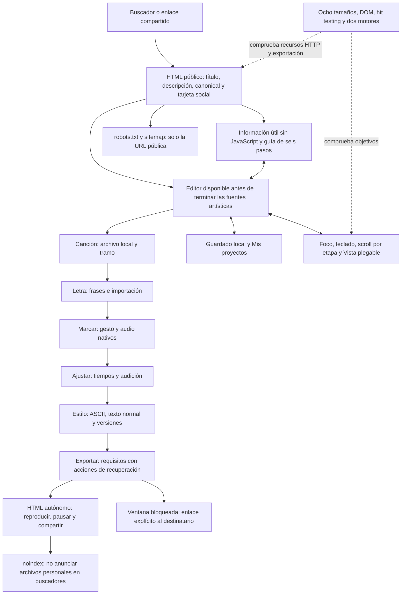

# Auditoría de SEO, UX y dispositivos

Base revisada: `9457ef601cca37bd592c8c2847f00e3bc4510bb7`. Esta auditoría usa capturas y pruebas nuevas; no reutiliza las de la auditoría anterior como evidencia. El objetivo es que una persona pueda entender el producto, cargar su canción, sincronizarla, corregirla, diseñarla, recuperar su trabajo y llevarse el resultado en móvil, tableta o escritorio.

## Diagrama y alcance



Se combinaron revisión visual, DOM y nombres accesibles, navegación real con teclado, clic y toque, hit testing de las acciones principales, respuestas HTTP, fuentes retenidas y bloqueo controlado de ventanas. Las capturas se inspeccionaron antes de aceptarlas. Los medios y letras son sintéticos. La captura inicial recorre seis etapas con marcas preparadas; la batería nueva completa además una captura nativa de tres frases y abre el destinatario real.

## Recorrido y salud después de corregir

1. **Entrada y Canción — corregido y comprobado.** Ahora explica el resultado, tiene guía accesible y permite empezar sin esperar a las fuentes artísticas. Conserva la elección de archivo y tramo. [Antes](images/seo-ux/01-inicio-antes.png) · [Después](images/seo-ux/01-inicio-despues.png).
2. **Letra — corregido y comprobado.** Mantiene una frase por línea y la importación opcional. Las etiquetas de inicio y final se asocian a sus campos y coinciden con sus nombres accesibles. Avanzar enfoca el paso nuevo; el CTA sigue accesible al reducir el viewport. [Captura inicial](images/seo-ux/02-letra-antes.png).
3. **Marcar — conservado y comprobado.** Se mantienen cuenta, modos, pausa, recuperación y ajuste opcional. Los botones de continuación trasladan el foco de forma explícita, también en motores que no enfocan botones al hacer clic. La batería nueva marca tres frases con toque y audio nativos. [Captura inicial](images/seo-ux/03-marcar-antes.png).
4. **Ajustar — conservado y comprobado.** Audición, precisión y controles siguen operativos. La navegación conserva la posición de trabajo al visitar otras etapas. [Captura inicial](images/seo-ux/04-ajustar-antes.png). Las suites existentes siguen verificando 101 casos de ajuste y 38 de lectura/exportación.
5. **Estilo — corregido y comprobado.** Al volver se recupera el scroll; en tableta se puede plegar Vista para editar con más espacio. Las opciones, versiones reversibles y modos independientes se conservan. [Captura inicial](images/seo-ux/05-estilo-antes.png) · [Espacio recuperado en tableta](images/seo-ux/07-tableta-despues.png).
6. **Exportar — corregido y comprobado.** Las acciones preceden al resumen para ser alcanzables en 320×568. Los requisitos pendientes ofrecen botones para resolverlos. Un popup bloqueado o una excepción ofrecen un enlace real, sin dejar el panel ocupado. [Antes en 320 px](images/seo-ux/06-exportar-320-antes.png) · [Después](images/seo-ux/06-exportar-320-despues.png) · [Recuperación](images/seo-ux/08-popup-despues.png).
7. **Guía y teclado — añadido y comprobado.** El botón `?` permanece accesible, el diálogo explica todas las funciones y lleva a cada etapa. Escape restaura el foco. Saltar al paso actual evita recorrer otra vez la cabecera y el transporte. [Guía](images/seo-ux/09-guia-despues.png).
8. **Proyectos y destinatario — corregido y comprobado.** Los nombres largos se parten dentro del diálogo y mantienen Borrar accesible; se conserva guardado y recuperación local. El destinatario real abre, reproduce audio y pausa. [Nombre largo antes](images/seo-ux/10-proyecto-antes.png) · [Después](images/seo-ux/10-proyecto-despues.png) · [Destinatario](images/seo-ux/11-destinatario-despues.png).

## Hallazgos y cambios

| ID | Problema o carencia comprobada | Corrección y comprobación |
|---|---|---|
| S01 | El HTML público enviaba `noindex`. | Producción usa `index, follow`; los builds de preview conservan `noindex`. Dos casos unitarios validan la distinción y el canonical de producción. |
| S02 | Faltaban descripción, canonical, metadatos sociales, imagen y descripción estructurada del producto. | HTML estático con Open Graph, Twitter, `WebApplication`, favicon y tarjeta 1200×630; la batería consulta los archivos reales del build. |
| S03 | `robots.txt` y `sitemap.xml` respondían 404 en producción. | El build genera ambos y el sitemap anuncia únicamente el editor público. |
| S04 | Sin JavaScript el body no explicaba el producto ni el recorrido. | Contenido HTML inicial útil, H1, seis pasos, información de guardado y aviso sin JavaScript. Es contenido del producto, sin datos de proyectos. |
| S05 | Retener las fuentes artísticas dejaba body vacío y cero pestañas tras 1,5 s. | [La captura diagnóstica](images/seo-ux/12-fuentes-bloqueadas-antes.png) muestra ese fallo de carga. La interfaz se monta antes de esperarlas y usa `font-display: swap`. Al terminar se recalculan las métricas del lienzo. Un fallo parcial no adelanta esa medición mientras las demás fuentes siguen pendientes. Se prueba que los controles y la guía funcionan con fuentes pendientes. |
| S06 | En móvil la entrada no explicaba qué resultado se obtiene ni existía ayuda global. | Introducción breve y guía accesible desde cualquier etapa, con instrucciones de guardado y apertura del HTML. La ayuda pausa la audición antes de abrirse. |
| S07 | Siguiente/Atrás o completar captura dejaban el foco en body o en el CTA anterior. En WebKit, el Tab posterior al salto volvía al inicio en lugar de alcanzar la acción del paso. | Foco explícito en el panel de destino, enlace de salto nativo y controles con elegibilidad secuencial explícita. Se respetan los índices negativos de pestañas inactivas y del selector recortado. El foco de los diálogos vuelve a su botón de origen. |
| S08 | Volver a Estilo cambiaba el scroll de 500 a 0. | Se conserva la posición por etapa y proyecto. Un proyecto diferente empieza con posiciones nuevas. |
| S09 | `field()` creaba textos visuales sin labels nativos; tocarlos no enfocaba su campo. El selector oculto de archivos también recibía foco en una caja recortada de 1×1 px. | Labels asociados para input/select/textarea y nombres para grupos. Los textos de inicio/final coinciden con el nombre accesible. El recorrido de teclado usa la acción visible Elegir canción, sin detenerse en el input recortado. |
| S10 | El nombre del proyecto anulaba el indicador de foco. | Se restaura `:focus-visible`, probado con modalidad de teclado. |
| S11 | Un nombre sin espacios producía 664 px de contenido dentro de un diálogo de 356 px y ocultaba Borrar. | `min-width: 0` y partición de palabras; se comprueba tamaño y punto de toque del control. |
| S12 | La tableta mostraba la vista previa permanentemente y no ofrecía el control Vista. | Se extiende el control plegable. En poco alto, plegarlo recupera también el ancho, evitando una columna vacía. |
| S13 | Exportar señalaba requisitos faltantes sin permitir resolverlos desde el aviso. | Acciones Elegir canción, Añadir letra, Marcar tiempos y Revisar tramo. |
| S14 | Un popup bloqueado fallaba silenciosamente; si `window.open` lanzaba una excepción, `making` quedaba activo. | Se captura la excepción y se ofrece un enlace al HTML construido. Se prueban ambos fallos y se abre el enlace mediante una acción real. |
| S15 | En 320×568 Descargar quedaba parcialmente detrás del pie fijo. | Las acciones preceden al resumen, con un mínimo de 44 px. El test comprueba sus límites y `elementFromPoint`, no solo que exista el botón. |
| S16 | El reloj preciso podía invadir Vista en 320 px. | Puede distribuirse en dos líneas, manteniendo los milisegundos. Se comprueban los rectángulos del texto frente a su caja. |
| S17 | Los HTML personales no solicitaban exclusión de buscadores. | Los exportados llevan `noindex, nofollow, noarchive` y el sitemap no anuncia destinatarios. |
| S18 | Los enlaces inexistentes terminaban en un error genérico sin retorno claro al producto. | El build proporciona una página 404 con retorno al editor y `noindex`, conservando el error HTTP real. |

`noindex` solicita que un buscador excluya el archivo; no constituye control de acceso si alguien lo aloja públicamente. La página pública y los documentos personales tienen reglas diferentes de forma intencionada.

## Mapa de implementación

- `scripts/site-document.mjs` y `build.mjs`: documento público, previews, datos estructurados, archivos de rastreo y 404. La URL pública se define en `SITE_URL`; hay que cambiarla si cambia el dominio principal.
- `assets/social-card.html`, `assets/social-card.png`, `assets/favicon.svg`: fuente y recursos gráficos propios del enlace público. La tarjeta usa tipografía de sistema y no necesita servicios externos.
- `js/guide-content.js`, `js/studio/guide.js`: una sola fuente de instrucciones para HTML inicial y guía del editor.
- `js/main.js`, `js/fonts.js`: montaje disponible mientras terminan las fuentes, sin conservar métricas de la tipografía de sustitución.
- `js/studio.js`, `js/studio/navigation.js`, `js/mark/*`, `js/words/view.js`: foco al avanzar, salto de navegación y scroll por etapa.
- `js/ui.js`, `js/panel-text.js`: etiquetas, grupos y nombres accesibles coherentes.
- `js/panel-export.js`, `js/export.js`: recuperación, prioridad de acciones y exclusión de destinatarios en buscadores.
- `css/style.css`, `css/mobile.css`: foco, objetivos táctiles, nombres largos, reloj, ayuda y espacio plegable en tableta/horizontal.
- `test/seo-ux.mjs`, `test/unit/seo.test.mjs`: contratos nuevos, incorporados a ambos jobs de CI. `test/reaudit.mjs` copia también los nuevos recursos al probar el montaje bajo una subruta.

## Pruebas y publicación

```sh
npm test
PLAYWRIGHT_BROWSER=webkit node scripts/test-browser.mjs smoke reliability reaudit mobile-capture adjust reading audit-boundaries seo-ux
```

La batería unitaria contiene 57 casos. La nueva suite cubre 166 comprobaciones: documentos y recursos SEO, JavaScript desactivado, fuentes retenidas y fallo parcial de fuentes, ocho tamaños, etiquetas, foco, ayuda, captura nativa, retorno al scroll, Vista plegable, objetivos alcanzables, popup bloqueado y excepción, destinatario real y exclusión del HTML personal. Los casos se contabilizan por ejecución, no por captura.

Matriz: 320×568, 390×700, 844×390, 768×1024, 1180×820, 1024×680, 1440×900 y 720×450. Este último representa el espacio CSS equivalente a una ventana de 1440×900 al 200%; no simula todos los efectos del zoom físico. En el teléfono de 390 px se reduce además la altura a 400 px mientras se escribe y se comprueba el toque del CTA; [Captura estable del espacio reducido](images/seo-ux/13-altura-reducida-despues.png). No se presenta como teclado virtual de un dispositivo físico.

El runner completo contiene 17 suites de Chromium y ocho de WebKit. La suite SEO/UX corre inmediatamente después de smoke para detectar pronto sus regresiones. La nueva suite tardó unos 30–51 s en local; el límite global de WebKit pasa de seis a ocho minutos para incorporar esta cobertura. Se conserva el límite individual de 180 s, las aserciones de audio nativo y la ausencia de reintentos para aprobar. Antes del primer gesto se comprueba el foco real de la ventana; un fallo de reproducción conserva trazas de eventos confiables y su destino. CI sigue usando Chromium/Ubuntu y WebKit/macOS con las acciones fijadas por SHA.

La integración requiere ambas tareas de CI aprobadas sobre la misma revisión. Después se contrasta el árbol integrado, el estado de Vercel en el proyecto existente y los hashes de los assets públicos. La comprobación pública debe revisar robots, sitemap, canonical, imagen y 404, completar captura/corrección/exportación y reproducir el HTML descargado en un documento independiente sin red. El resultado final y sus enlaces se registran en la PR y en el cierre de esta auditoría.

## Límites

No se afirma una posición en Google, un resultado de Search Console ni una puntuación Lighthouse medida: no hubo acceso a esos datos. Las pruebas visuales y de DOM no certifican WCAG completa ni lectores de pantalla. Las dimensiones y toques son emulados; WebKit automatizado no equivale a Safari/iOS físicos. Se conserva la revisión de códecs de la batería existente y no se atribuyen a esta auditoría formatos que no se hayan ejecutado.
