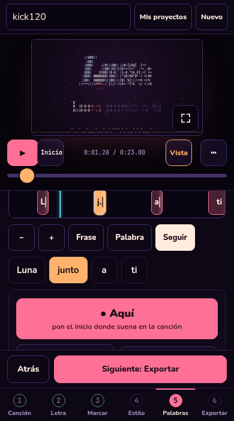
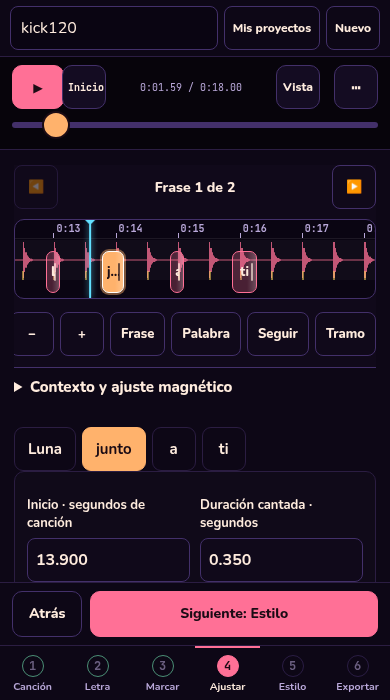
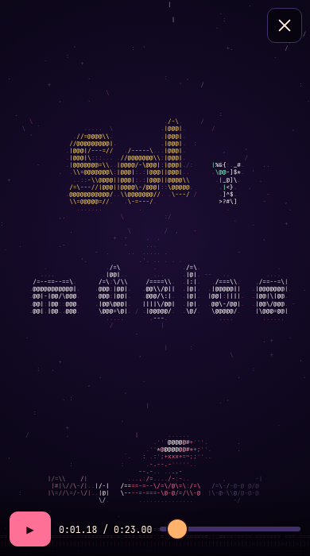

# Timeline, lectura y variantes

## Contexto y base

Trabajo iniciado el 25 de octubre de 2026 desde `e7ed2be6d8d3d41d716fff9aa4c9511837de4f31`, comprobado tanto en el checkout como en `refs/heads/main` del remoto. El punto de partida incluye las reparaciones de fiabilidad de PR #2 (`bf0a284`) y de captura móvil de PR #3 (`e7ed2be`). Se conservan IndexedDB v2, proyectos v3, importaciones antiguas, exportación por instantánea y el espacio de captura independiente del formato.

El encargo adjunto informa un despliegue previo READY (`dpl_Gcm4viFP4jV9wRUzFxNrnuMfJhtU`) en el proyecto existente `letras-ascii`. Ese estado de Vercel no se pudo confirmar desde esta máquina: el dominio público y la API de GitHub devolvieron 403 del proxy de red. Un HEAD publicado en GitHub no demuestra por sí mismo qué versión sirve producción.

La aplicación continúa siendo JavaScript por módulos + Canvas 2D, compilado con esbuild y Node 24. Audio, proyectos e importaciones son locales. No se agregan cuentas, backend, transcripción, alojamiento de medios, MP4 ni integración con GLYPHOS.

## Recorrido y requisitos implementados

Canción → Letra → Marcar → **Ajustar** → Estilo → Exportar. El ID interno `words` se conserva. Desde el resultado de marcado se puede omitir Ajustar e ir a Estilo.

- La tira es el centro de Ajustar. Seleccionar pausa la audición y deja de seguir el reloj; escuchar no reactiva Seguir. La onda, el cursor y las marcas usan segundos del tramo; los campos numéricos muestran segundos absolutos de la canción. El timeline de edición se construye desde el proyecto y funciona con Vista plegada.
- Escuchar reproduce una palabra, frase o el rango visible, con 300 ms previos y 600 ms posteriores por defecto. Ambos márgenes se ajustan entre 0 y 3 segundos. A–B repite ese rango, sin tocar `clip`, `offset`, marcas o semilla. Se usan 0.5×, 0.75× o 1× y `preservesPitch` cuando existe. Salir de Ajustar, cambiar medios/tramo/proyecto o desmontar detiene la audición.
- Inicio y duración admiten milisegundos, nudges de 20/100 ms y atajos existentes. Una frase se desplaza conservando sus intervalos. Zoom alrededor de selección, encuadres de palabra/frase/tramo y desplazamiento manual no activan seguimiento. El magnetismo opcional usa cursor, vecinos y cuadrícula de 100 ms con umbral de 35 ms; no interpreta los graves como fonemas.
- Un arrastre confirma una sola edición; las pulsaciones sostenidas y sliders se agrupan. Cancelar, `pointercancel`, perder captura o foco restaura el estado temporal. Deshacer/rehacer conserva instantáneas de `sync`, `style`, `over`, `seed` y `offset`; cambiar proyecto, letra, canción o tramo invalida la historia correspondiente. No restaura datos sobre otra letra.
- Las entradas tienen selección global y override por palabra: heredar, instantánea, rápida o efecto. Rápida propone 80 ms. La entrada efectiva se limita al 25% de la ventana disponible antes de la siguiente palabra/salida; un efecto demasiado lento usa una alternativa corta y el inspector muestra la limitación. Cero no se sustituye por un default. `wd` sigue significando duración cantada.
- Letras principales y karaoke tienen modos ASCII/texto normal independientes. El texto normal se dibuja con fuentes locales después del renderer ASCII, con transformaciones y composición aisladas. El karaoke tiene fuente, tamaño, detalle ASCII, contraste y visibilidad propios; la bolita usa las mismas medidas que el texto. Frases largas se segmentan en páginas de hasta dos líneas y palabras excepcionalmente largas se parten conservando todos sus caracteres. La activa se subraya, además del color. Se reserva espacio para los controles del destinatario y de pantalla completa.
- Generar otra versión está visible al inicio de Estilo, con Sutil/Equilibrado/Intenso y grupos de fuentes, colores, fondos y animaciones. Se reutiliza `seed`; los overrides manuales y los ajustes de lectura se conservan. Deshacer recupera la generación anterior; Conservar guarda la actual en IndexedDB.

## Mapa del código actual

| Área | Archivos y responsabilidades |
|---|---|
| Navegación y composición | `js/studio.js`, `js/studio/navigation.js`, `js/mark/view.js`, `js/mark/session.js`: orden, rutas, omisión de Ajustar y captura existente. |
| Edición | `js/panel-words.js`: selección, inspector y timeline de edición cacheado; `js/words/view.js` y `controls.js`: layout y transporte; `timing.js`: conversiones, límites y materialización; `support.js`: repetición de nudges. |
| Gestos | `js/strip.js`: bloques visibles reutilizados, pan/pinch/zoom, cancelación temporal, magnetismo y rango A–B dibujado. |
| Historial | `js/edit-history.js`: instantáneas, agrupación, cancelación y contexto de proyecto/letra; usa el lifecycle del editor. |
| Audición | `js/words/audition.js`: calcula el rango temporal; `js/player.js`: ejecuta sus límites usando el reloj audible. No hay un segundo reloj. |
| Contrato y dirección | `js/project.js`: defaults y normalización v3; `js/timeline.js`: composición; `js/director.js`: variación determinista y overrides; `js/entry.js`: entrada efectiva después de agrupar y resolver salidas. |
| Render | `js/scene.js`: composición; `js/text-layer.js`: letras vectoriales, medidas y páginas de karaoke, raster ASCII inferior y bolita. `type.js`, `grid.js`, `fx.js` conservan el motor ASCII y sus efectos. |
| Diseño global | `js/panel-style.js`, `js/style-controls.js`: modos, entradas, karaoke, variantes e historial. `css/style.css` y `css/mobile.css`: timeline fija, controles precisos y adaptación al poco alto. |
| Datos y exportación | `storage/*`, `store.js`, `export.js`, `panel-export.js`: rutas existentes. `panel-text.js` conserva milisegundos al reimportar; `player-bootstrap.js` monta el renderer independiente y reserva el área real de controles. |
| Validación | `test/unit/editing.test.mjs`, `test/adjust.mjs`, `test/reading.mjs`; incorporados a los runners existentes y al job WebKit correspondiente. |

## Persistencia y migración

Se extiende v3 sin cambiar su versión. Campos nuevos en `style`: `mainMode`, `mainFace`, `mainColor`, `karaokeMode`, `karaokeFace`, `karaokeSize`, `karaokeDetail`, `karaokeContrast`, `karaokeOn`, `entryFx`, `entryMs` y `randomGroups`. Overrides de palabra nuevos: `mode` y `entryMs`; `fx` también admite `instant` y `quick`. Quitar el override vuelve a heredar.

Los proyectos nuevos usan principal ASCII, karaoke normal y entrada rápida de 80 ms. Al normalizar proyectos anteriores con estilo pero sin `mainMode`, se conserva principal/karaoke ASCII y entrada automática. Las entradas automáticas también reciben el límite de lectura; la selección aleatoria usa ahora grupos explícitos, por lo que una versión anterior puede cambiar visualmente al recalcularse con el motor nuevo. Tiempos, letra, audio, tramo y decisiones manuales se conservan. Los HTML antiguos ya descargados contienen su propio reproductor y no se reescriben.

`sync.t` y `wt` son posiciones absolutas; `wd` son duraciones. Al dibujar se resta `clip.start` y se aplica `offset`; al guardar desde el reloj se revierte ese offset una sola vez. Exportar sigue incluyendo tiempos relativos y `sourceStart`; importar vuelve a sumar ese origen y conserva tres decimales.

## Plan y pruebas

1. Registrar el antes con audio sintético y revisar los módulos afectados, sin repetir una auditoría general.
2. Separar timeline de edición, seguimiento, audición e historial; verificar gestos y clip no nulo.
3. Extender v3 y resolver entradas después de agrupaciones/salidas; comprobar píxeles realmente dibujados.
4. Añadir modos independientes, medidas, segmentos y geometría de bolita; exportar/reimportar pronto.
5. Dar presencia a variantes, proteger manuales y revisar navegación, targets y pantallas pequeñas.
6. Ejecutar regresiones completas e inspección visual; publicar solo el SHA concreto validado.

Las nuevas pruebas unitarias cubren ventanas rápidas en ambas composiciones, cero global/por palabra, normalización, importación, determinismo y grupos de azar. `adjust` ejercita selección nativa, A–B, 100 ms exactos con clip 12/offset -120 ms, cancelación de gestos, duración, historial agrupado, velocidad y generación reversible en 320, 390 y 1440 px. `reading` compara píxeles con/sin cada palabra en las cuatro combinaciones de modos y ambos focos, valida geometría en nueve tamaños, descarga HTML real, lo reproduce sin recursos externos, reimporta y recupera desde IndexedDB.

```sh
export PLAYWRIGHT_EXECUTABLE_PATH=/usr/bin/chromium
npm run lint
npm run test:unit
npm run build
npm run test:browser -- adjust reading words reaudit
npm test
```

El runner completo incluye ahora 15 suites. El job WebKit de CI incluye `adjust` y `reading`; configurar ese job no equivale a haberlo ejecutado desde esta máquina. Las capturas están en `test/audit/timeline/` (ignorado por Git). Los casos AAC/Opus/MP3 de reauditoría son condicionales a fixtures locales. No se certifican iPhone/Safari físicos ni teclado virtual real mediante emulación de viewport.

## Publicación

## Resultado de la validación local

Commit funcional: `4526430`. Node 24.19.0, Playwright Core 1.64.1 y Chromium del sistema 154.0.8037.57, en Linux.

| Comprobación | Resultado |
|---|---|
| Batería completa `npm test` con `PLAYWRIGHT_EXECUTABLE_PATH` | Aprobada: lint, build, 25 unitarias de ese punto y las 15 suites de navegador. |
| Cierre tras los ajustes finales | Lint, build y 28 unitarias aprobados; repeticiones dirigidas de Ajustar, lectura/exportación y Palabras aprobadas. |
| Ajustar | 31 comprobaciones; toque, mouse y teclado; 320×568, 390×700 y 1440×900. Incluye seleccionar otra frase sin recentrar y reanudar al final de A–B. |
| Lectura/exportación | 38 comprobaciones; cuatro combinaciones de render, dos focos, nueve tamaños, siete familias, reduced motion y recorrido de descarga/reproducción/reimportación/recarga. |
| Captura móvil existente | 107 comprobaciones aprobadas en Chromium; cinco tamaños y tres formatos, con toques nativos. |
| UX existente | Matriz de 14 tamaños aprobada. |
| No ejecutado aquí | WebKit; teléfonos físicos/teclado virtual; tres fixtures condicionales AAC/Opus/MP3 que no estaban disponibles. |

Las últimas regresiones cubren también una elección manual de fuente/color en la última palabra: una heurística de rima podía reemplazarla, y ahora la decisión manual vuelve a aplicarse después de la heurística.

## Evidencia visual

| Antes, base `e7ed2be` | Después, esta implementación |
|---|---|
|  |  |
|  |  |

La comparación de karaoke usa la misma frase sintética, viewport 390×700, tramo iniciado en 12 s, offset de -120 ms y tiempo del reproductor 1.18 s. La base rasteriza las letras a ASCII; la nueva captura elige el modo normal. La comparación de edición muestra la previsualización abierta de la base y la edición con Vista plegada en la herramienta nueva.

El [HTML autónomo reproducido](images/timeline/exported-karaoke.png) incluye fuentes locales incrustadas y reserva el espacio de sus controles. Las pruebas bloquearon recursos externos y comprobaron el audio real, los ajustes nuevos y la reimportación con precisión de milisegundos.

## Publicación

Rama de trabajo: `codex/timeline-legibilidad-ux`. Mantener el proyecto Vercel `letras-ascii`, build `node build.mjs` y salida `site/`. No editar bundles generados ni crear un segundo proyecto.

Antes de integrar: CI del commit final verde, revisión del diff y PR con problema, comportamiento y evidencia. Después: verificar que el despliegue de producción está READY, que su `githubCommitSha` coincide con el commit integrado y que el dominio público sirve sus recursos. Ejecutar allí selección/corrección y descarga real con audio sintético; registrar PR, commit y despliegue. Un preview o un build local no cumplen esta comprobación.

La red actual bloqueó API de GitHub y dominio público. Se guardaron adiciones para `api.github.com`, `letras-ascii.vercel.app`, `api.vercel.com` y `vercel.com` en el borrador del entorno; guardarlas no las aplica ni publica. No hacen falta secretos para desarrollar localmente. Antes de solicitar credenciales de despliegue, comprobar la integración GitHub–Vercel y las autenticaciones existentes.
